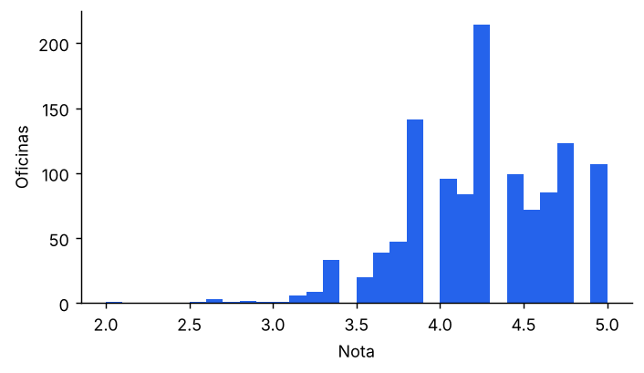
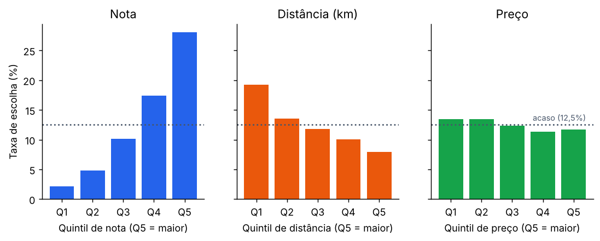
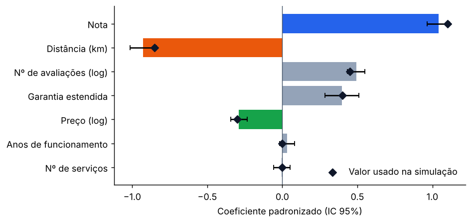
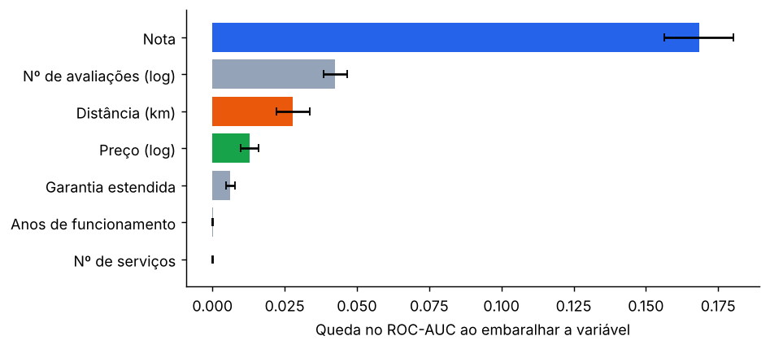
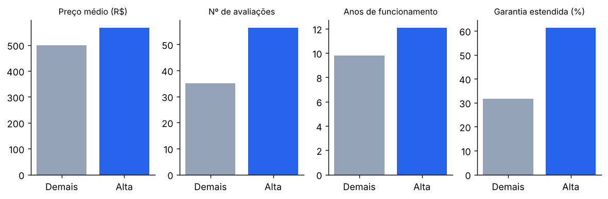
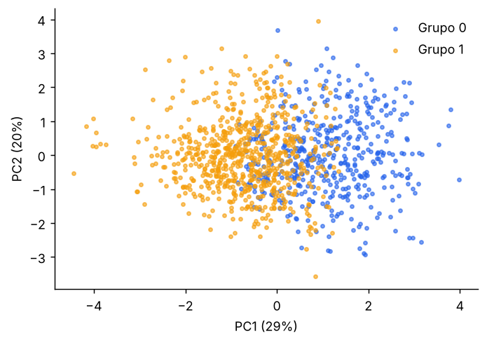

# TechMotors: análise da escolha de oficinas mecânicas

**Documento do Projeto de Ciência de Dados (CRISP-DM)**

| | |
|---|---|
| Instituição | UDF – Centro Universitário do Distrito Federal |
| Curso / disciplina | Sistemas de Informação / Ciência de Dados e Aprendizado de Máquina |
| Equipe | Thiago Regis Vieira Rocha · Eduardo Santos Morais |
| Professor | Eliel |
| Versão | 1.0 (novembro de 2026) |

> ⚠️ **Aviso metodológico.** Todos os resultados deste documento vêm de uma **base simulada**, calibrada a partir de uma pesquisa de mercado. Eles demonstram que o método funciona, mas **não descrevem o comportamento de clientes reais**. A seção 14 detalha essa limitação.

---

## Sumário

1. Introdução
2. Problema de negócio
3. Objetivos
4. Metodologia CRISP-DM
5. Entendimento do negócio
6. Entendimento dos dados
7. Preparação dos dados
8. Análise exploratória
9. Modelagem
10. Avaliação
11. Resultados e insights
12. Dashboard (implantação)
13. Conclusão
14. Limitações
15. Trabalhos futuros
16. Referências

---

## 1. Introdução

A TechMotors é uma plataforma de agendamento que intermedia o contato entre motoristas e oficinas mecânicas qualificadas e bem avaliadas. Para a plataforma ordenar as oficinas de forma útil, é preciso saber o que de fato pesa na escolha do cliente.

Pesquisa recente do IQA em parceria com a Ipsos, com cerca de 400 proprietários de veículos, aponta que a confiança nos profissionais (33%), a qualidade dos serviços (17%) e a garantia (17%) pesam mais que o preço (8%) na escolha da oficina (PORTAL DA AUTOPEÇA, 2026). A pesquisa, porém, não mede a distância e não permite comparar os fatores entre si dentro de uma mesma decisão.

Este projeto constrói, segundo a metodologia CRISP-DM (IBM, 2015), um pipeline completo de dados que estima esse peso relativo e publica a resposta em uma dashboard interativa.

## 2. Problema de negócio

O motorista tem várias oficinas por perto e pouca informação confiável para decidir: os preços variam muito, a qualidade técnica é difícil de verificar e a escolha costuma depender de indicação. A oficina, por sua vez, não sabe se compensa investir em reputação, em preço ou em localização.

**Pergunta principal:** os clientes escolhem a oficina mais pela nota, pela distância ou pelo preço?

**Subpergunta:** quais características separam as oficinas mais bem avaliadas das demais?

### 2.1 Relação com o documento de definição

O documento de definição (Unidade III, v0.1) previa três perguntas: as melhores oficinas e por quê, a sazonalidade dos agendamentos e o ticket médio. Depois da apresentação inicial, o foco passou para a pergunta principal acima. A primeira pergunta original é respondida pela subpergunta e pelo ranking de reputação (seção 11.4). As perguntas de sazonalidade e ticket médio dependem de dados transacionais reais da plataforma e ficaram para trabalhos futuros (seção 15).

## 3. Objetivos

**Objetivo geral:** identificar e quantificar quais características de uma oficina se associam à escolha do cliente, e entregar a resposta em uma dashboard interativa.

**Objetivos específicos:**

| Nº | Objetivo | Evidência de conclusão | Situação |
|---:|---|---|---|
| 1 | Montar uma base com pelo menos 1.000 registros, com dicionário e tratamento documentado | `data/raw`, `data/processed` e dicionário no README técnico | ✅ |
| 2 | Medir o peso relativo de nota, distância e preço na escolha | Logit condicional e importância por permutação (seções 9 e 10) | ✅ |
| 3 | Criar um ranking de reputação com nota ajustada pelo volume de avaliações | Ranking top 10 (seção 11.4) | ✅ |
| 4 | Descrever o que diferencia as oficinas mais bem avaliadas | Testes de grupo e árvore de decisão (seção 10.3) | ✅ |
| 5 | Publicar os resultados em uma dashboard com KPIs, filtros e conclusão | `prototipo/dashboard/app.py` (seção 12) | ✅ |

## 4. Metodologia CRISP-DM

O CRISP-DM organiza um projeto de dados em seis fases iterativas: entendimento do negócio, entendimento dos dados, preparação, modelagem, avaliação e implantação (IBM, 2015). A Tabela 1 relaciona cada fase às seções deste documento e aos arquivos do repositório.

**Tabela 1 – Fases do CRISP-DM no projeto**

| Fase | Seção | Arquivo principal |
|---|---|---|
| 1. Entendimento do negócio | 5 | este documento |
| 2. Entendimento dos dados | 6 | `src/gerar_dados.py` |
| 3. Preparação dos dados | 7 | `src/preparacao.py` |
| 4. Modelagem | 8 e 9 | `src/analise.py`, `sql/consultas.sql` |
| 5. Avaliação | 10 | `resultados/resultados.json` |
| 6. Implantação | 12 | `dashboard/app.py` |

## 5. Entendimento do negócio

### 5.1 Público e decisão apoiada

| Público | Decisão que o resultado apoia |
|---|---|
| Motorista | Escolher a oficina pelo ranking de reputação da plataforma |
| Dono de oficina | Decidir se investe em reputação (avaliações, garantia) ou em preço |
| Plataforma TechMotors | Definir quais fatores entram e com que peso no ordenamento das oficinas |

### 5.2 Hipóteses

| ID | Hipótese | Origem |
|---|---|---|
| H1 | Notas mais altas aumentam a probabilidade de escolha | Este projeto |
| H2 | Menor distância aumenta a probabilidade de escolha | Este projeto |
| H3 | Preço menor aumenta a probabilidade de escolha | Este projeto |
| H4 | O volume de avaliações funciona como sinal de confiança | Este projeto |
| H5 | Oficinas mais bem avaliadas têm características diferentes das demais | Este projeto |
| H1-Def | Oficinas com nota acima de 4,0 recebem pelo menos 40% mais agendamentos | Documento de definição |
| H2-Def | Mostrar o preço antes do agendamento reduz cancelamentos | Documento de definição |

### 5.3 Critérios de sucesso

| Tipo | Critério | Meta |
|---|---|---|
| Negócio | Responder à pergunta com uma ordem de fatores sustentada por dois métodos independentes | Ordem igual no logit condicional e na importância por permutação |
| Mineração de dados | Recuperar os parâmetros usados na simulação | Sinal e ordem corretos, e valor verdadeiro dentro do IC 95% |
| Mineração de dados | Prever a oficina escolhida melhor que o acaso | Acerto top-1 acima de 12,5% (1 em 8) |

### 5.4 Riscos

| Risco | Impacto | Resposta adotada |
|---|---|---|
| Não existir dado público de escolha de oficina | Alto | Base simulada calibrada pela pesquisa IQA/Ipsos, com pipeline pronto para receber dados reais |
| Conclusão sobre dados simulados ser tomada como real | Alto | Aviso explícito no documento, no README e na dashboard |
| Fontes sem dado de distância | Médio | Peso da distância declarado como suposição |

## 6. Entendimento dos dados

### 6.1 Avaliação das fontes

**Tabela 2 – Fontes consultadas e uso no projeto**

| Fonte | Tipo | Uso |
|---|---|---|
| IQA/Ipsos (2026), via Portal da Autopeça | Pesquisa de percepção (≈ 400 entrevistas) | **Calibração dos parâmetros:** confiança 33%, qualidade 17%, garantia 17%, preço 8%. Tipos de estabelecimento: independentes 53%, concessionárias 20%, centros automotivos 17% |
| Maia et al. (2021) | Estudo de caso qualitativo (1 oficina) | Contexto: problemas de atendimento e de tempo de espera. Sem dados quantitativos de clientes |
| Muritiba-BA (ResearchGate) | Avaliação de qualidade de serviço | Não lido: acesso bloqueado. Pendente |
| Moysés (2023; 2024a; 2024b) | Artigos de opinião | Contexto teórico sobre qualidade e confiança no setor automotivo. Sem dados |
| IBM (2015) | Guia metodológico | Estrutura CRISP-DM |

Nenhuma fonte traz dados por oficina nem a escolha observada de um cliente. Por isso o projeto gera uma base simulada.

### 6.2 Desenho da base simulada

- **1.200 oficinas** em 15 regiões administrativas do DF, com nota, número de avaliações, preço médio de uma revisão básica, número de serviços, anos de funcionamento, garantia estendida e tipo de estabelecimento.
- **2.000 clientes.** Cada cliente compara **8 oficinas**, sorteadas entre as 30 mais próximas com pelo menos uma avaliação, e escolhe uma. Isso gera **16.000 pares cliente × oficina**.
- Uma **qualidade latente**, não observada, gera ao mesmo tempo a nota, a garantia e o tempo de mercado. É isso que cria diferenças reais entre as oficinas para a subpergunta.
- A escolha segue um **modelo logit multinomial**, com variáveis padronizadas:

`utilidade = 1,10·nota − 0,85·distância + 0,45·log(avaliações) + 0,40·garantia − 0,30·log(preço) + erro`

- A ordem dos pesos (nota e confiança acima de preço) segue a pesquisa IQA/Ipsos. **O peso da distância é uma suposição**, porque a pesquisa não mede proximidade. Anos de funcionamento e número de serviços entram com peso zero, como controle: o modelo não pode "inventar" efeito para eles.
- Para demonstrar o tratamento, foram inseridos problemas típicos de dados reais: duplicatas, grafia inconsistente, preço digitado como texto, notas fora da escala e valores negativos.

### 6.3 Estrutura relacional

A base tem três tabelas (`oficinas`, `clientes` e `escolhas`), ligadas por `id_oficina` e `id_cliente`, e é gravada em SQLite. O dicionário completo está no [README técnico](../prototipo/README.md#dicionário-de-dados).

## 7. Preparação dos dados

**Tabela 3 – Tratamentos aplicados (registrados automaticamente pelo pipeline)**

| Problema | Ocorrências | Tratamento | Justificativa |
|---|---:|---|---|
| Linhas duplicadas | 12 | Removidas pelo `id_oficina` | Mesmo registro repetido |
| Grafia da região | 50 | Padronizada pela lista oficial | Caixa, espaços e acentos diferentes |
| Preço como texto ("R$ 1.234,56") | 8 | Convertido para número | Erro de formato |
| Preço ausente | 24 | Mediana do tipo de estabelecimento, com marcação `preco_imputado = 1` | O preço varia muito por tipo, então a mediana geral distorceria |
| Nota fora de 1–5 (ex.: 45) | 5 | Dividida por 10 | Vírgula perdida na digitação |
| Anos de funcionamento negativos | 3 | Valor absoluto | Erro de sinal |
| Nota ausente | 15 | **Mantida ausente** | Oficina sem avaliações não tem nota. Imputar seria inventar reputação |
| Outliers (IQR) | 40 em preço, 88 em avaliações, 35 em anos | **Sinalizados, não removidos** | São valores plausíveis (concessionária cara, oficina muito avaliada). Os modelos usam logaritmo |

**Atributos criados:**
- `log_preco` e `log_avaliacoes`: reduzem a assimetria das variáveis.
- `nota_ajustada`: média bayesiana `(n·nota + m·média)/(n + m)`, com m = 31 (mediana de avaliações). Ela evita que uma oficina com uma única nota 5 fique à frente de outra com centenas de avaliações.
- `grupo_avaliacao`: quartis da nota entre oficinas com pelo menos 10 avaliações. Ficaram Alta (≥ 4,6), Baixa (≤ 4,0) e Intermediária. Usamos quartis porque as notas se concentram entre 4 e 5, e um corte fixo como 4,5 seria arbitrário.
- `faixa_preco` e `faixa_distancia`: categorias para leitura na dashboard.

## 8. Análise exploratória

**Tabela 4 – Estatística descritiva das oficinas (n = 1.200)**

| Variável | Média | Desvio-padrão | Mínimo | Mediana | Máximo |
|---|---:|---:|---:|---:|---:|
| Nota (n = 1.185) | 4,23 | 0,46 | 2,0 | 4,2 | 5,0 |
| Nº de avaliações | 47,7 | 52,7 | 0 | 31 | 392 |
| Preço médio (R$) | 552,72 | 184,67 | 222,59 | 515,92 | 1.395,71 |
| Nº de serviços | 11,1 | 4,2 | 2 | 10 | 28 |
| Anos de funcionamento | 12,4 | 8,8 | 0,5 | 10,1 | 45,0 |

*Figura 1 – Distribuição das notas. As notas se concentram entre 4 e 5, padrão comum em plataformas de avaliação.*

**Correlação de Spearman.** Usamos Spearman porque as variáveis são assimétricas e a relação não precisa ser linear.

| Par | ρ | p-valor | Nível |
|---|---:|---:|---|
| Nota × preço | 0,197 | < 0,001 | oficina |
| Nº de avaliações × nota | 0,263 | < 0,001 | oficina |
| Nota × distância | 0,002 | 0,80 | par cliente × oficina |
| Preço × distância | −0,005 | 0,52 | par cliente × oficina |

Oficinas mais bem avaliadas tendem a ser um pouco mais caras e a ter mais avaliações. Nota e preço não dependem da distância, o que faz sentido, porque a distância depende de onde está o cliente.

**KPIs da pergunta (SQL, `sql/consultas.sql`):**

| Indicador | Valor |
|---|---:|
| Clientes que escolheram a oficina de **maior nota** do seu conjunto | 38,4% |
| Clientes que escolheram a oficina **mais próxima** | 22,6% |
| Clientes que escolheram a oficina **mais barata** | 14,6% |
| Valor esperado se a escolha fosse ao acaso | 12,5% |

| Situação | Nota média | Distância média | Preço médio | Avaliações (média) |
|---|---:|---:|---:|---:|
| Oficina escolhida | 4,55 | 1,79 km | R$ 538,86 | 78,5 |
| Oficina preterida | 4,18 | 2,17 km | R$ 546,86 | 44,5 |

*Figura 2 – Taxa de escolha por quintil de nota, distância e preço. A linha pontilhada marca o acaso (12,5%). A nota tem a variação mais forte, a distância vem em seguida e o preço quase não se afasta do acaso.*

## 9. Modelagem

**Tabela 5 – Técnicas utilizadas**

| Técnica | Finalidade | Por que foi escolhida |
|---|---|---|
| **Logit condicional** | Pergunta principal | Cada cliente escolhe 1 entre 8 opções. O modelo compara a escolhida com as preteridas **do mesmo cliente**, o que uma regressão comum não faz |
| Regressão logística, árvore de decisão, Random Forest, Gradient Boosting | Prever a oficina escolhida | Comparar modelos lineares e não lineares |
| Importância por permutação | Ranking de variáveis | Funciona com qualquer modelo e confere o resultado do logit por outro caminho |
| Mann-Whitney, qui-quadrado e árvore rasa | Subpergunta | Comparar grupos sem supor normalidade e gerar regras legíveis |
| K-Means + PCA | Grupos naturais de oficinas | Aprendizado não supervisionado. O número de grupos foi escolhido pela silhueta |

**Desenho de teste:** os modelos de previsão foram treinados com 75% dos clientes e testados nos outros 25% (500 clientes). A divisão foi feita **por cliente**, para que as 8 alternativas de um mesmo cliente nunca fiquem metade no treino e metade no teste. Todas as etapas aleatórias usam a semente 42.

**Métrica principal de previsão:** acerto top-1, ou seja, o percentual de clientes em que a oficina com maior probabilidade prevista foi de fato a escolhida. Usamos essa métrica porque cada cliente escolhe exatamente uma oficina; nesse caso, precisão e revocação ficam iguais ao acerto top-1. A acurácia comum seria enganosa: um modelo que dissesse "não escolhida" para tudo já acertaria 87,5%.

**PySpark:** não foi usado. Com 16 mil linhas o pandas processa tudo em segundos, e usar Spark aqui seria artificial. Ele passa a fazer sentido se a coleta real chegar a milhões de linhas, por exemplo com avaliações individuais.

**Orange Data Mining:** não foi realizado nesta versão. Para repetir a comparação de modelos visualmente, carregue `data/processed/escolhas_modelagem.csv` no widget *File*, defina `escolhida` como alvo, ligue *Logistic Regression* e *Random Forest* ao widget *Test and Score* e compare a AUC.

## 10. Avaliação

### 10.1 Pergunta principal: logit condicional

**Tabela 6 – Coeficientes padronizados × parâmetros da simulação (pseudo-R² de McFadden = 0,275)**

| Variável | Coeficiente | IC 95% | p-valor | Valor usado na simulação |
|---|---:|---|---:|---:|
| Nota | +1,04 | 0,97 a 1,11 | < 0,001 | +1,10 |
| Distância | −0,93 | −1,01 a −0,84 | < 0,001 | −0,85 |
| Nº de avaliações (log) | +0,49 | 0,43 a 0,55 | < 0,001 | +0,45 |
| Garantia estendida | +0,40 | 0,29 a 0,51 | < 0,001 | +0,40 |
| Preço (log) | −0,29 | −0,35 a −0,24 | < 0,001 | −0,30 |
| Anos de funcionamento | +0,03 | −0,02 a 0,08 | 0,21 | 0 |
| Nº de serviços | −0,00 | −0,06 a 0,05 | 0,90 | 0 |

*Figura 3 – Coeficientes estimados (barras, com IC 95%) e valores usados na simulação (losangos).*

O valor usado na simulação ficou dentro do IC 95% **em todas as 7 variáveis**, com sinal e ordem corretos, e as duas variáveis de controle não ganharam efeito falso. **O critério de sucesso de mineração foi atingido.**

### 10.2 Modelos de previsão

**Tabela 7 – Desempenho no conjunto de teste (500 clientes, 4.000 pares)**

| Modelo | ROC-AUC | PR-AUC | Acerto top-1 |
|---|---:|---:|---:|
| Regressão logística | **0,782** | **0,344** | **43,0%** |
| Gradient Boosting | 0,776 | 0,343 | 41,2% |
| Random Forest | 0,769 | 0,330 | 39,2% |
| Árvore de decisão | 0,754 | 0,303 | 37,2% |
| Acaso | 0,500 | 0,125 | 12,5% |

O modelo mais simples ganhou. É o esperado, porque os dados foram gerados por um processo logístico; com dados reais, os modelos não lineares podem se sair melhor. A regressão logística acertou a oficina escolhida em 215 dos 500 clientes, 3,4 vezes mais que o acaso.

*Figura 4 – Importância por permutação na regressão logística: quanto o ROC-AUC cai quando cada variável é embaralhada.*

A ordem do trio da pergunta (nota > distância > preço) é **a mesma** no logit condicional e na importância por permutação, o que atende ao critério de sucesso de negócio. O número de avaliações aparece acima da distância na permutação. Isso acontece porque a permutação mede a previsão em todos os pares misturados, enquanto a distância só faz diferença quando comparada dentro do conjunto de cada cliente, que é exatamente o que o logit condicional captura. Por isso o logit condicional é o modelo de referência para a pergunta.

### 10.3 Subpergunta: oficinas de alta avaliação × demais

**Tabela 8 – Comparação entre grupos (272 de alta avaliação × 718 demais)**

| Característica | Alta (mediana) | Demais (mediana) | Tamanho do efeito | p-valor |
|---|---:|---:|---:|---:|
| Nº de avaliações | 56,5 | 35,0 | 0,27 | < 0,001 |
| Preço médio (R$) | 567,77 | 499,75 | 0,21 | < 0,001 |
| Anos de funcionamento | 12,1 | 9,8 | 0,14 | < 0,001 |
| Garantia estendida | 61,4% | 31,8% | — | < 0,001 (χ²) |
| Nº de serviços | 11 | 11 | 0,00 | 0,91 |
| Tipo de estabelecimento | 24% são concessionárias | cerca de 16% | — | 0,06 (χ², não significativo) |

O tamanho do efeito é a correlação rank-biserial: em torno de 0,1 é pequeno, 0,3 é médio e 0,5 é grande.

*Figura 5 – Medianas (e % para garantia) das oficinas de alta avaliação comparadas às demais.*

Uma árvore de decisão com três níveis, **sem usar a nota**, separa as oficinas de alta avaliação das demais com ROC-AUC de 0,69 em validação cruzada de 5 partes. A garantia estendida (importância 0,50) e o número de avaliações (0,35) são as variáveis mais usadas pela árvore.

### 10.4 Grupos naturais (K-Means)

A maior silhueta foi com **k = 2 (0,22)**. Valores abaixo de 0,25 indicam estrutura **fraca**: os grupos existem, mas se sobrepõem bastante.

| Grupo | Oficinas | Nota | Avaliações | Preço | Garantia | Concessionárias |
|---|---:|---:|---:|---:|---:|---:|
| 0 | 474 | 4,5 | 38 | R$ 569 | 94% | 29% |
| 1 | 711 | 4,1 | 27 | R$ 489 | 1% | 12% |

*Figura 6 – Grupos do K-Means projetados nos dois primeiros componentes principais (49% da variância).*

O K-Means separou basicamente quem oferece garantia de quem não oferece. Isso confirma a subpergunta por outro caminho, mas não revela perfis novos.

### 10.5 Hipóteses

| ID | Resultado na base simulada |
|---|---|
| H1 | ✅ Suportada (coeficiente +1,04, p < 0,001) |
| H2 | ✅ Suportada (−0,93, p < 0,001) |
| H3 | ✅ Suportada, mas com o menor efeito entre os três fatores (−0,29, p < 0,001) |
| H4 | ✅ Suportada (+0,49, p < 0,001) |
| H5 | ✅ Suportada: avaliações, preço, tempo de mercado e garantia diferem |
| H1-Def | ✅ Suportada: oficinas com nota acima de 4,0 foram escolhidas em 17,5% das vezes em que apareceram, contra 3,0% das demais (+480%, meta de +40%, p < 0,001). A taxa de escolha foi usada como proxy de agendamento |
| H2-Def | ❌ Não testável: a base não tem cancelamento nem exibição prévia de preço |

### 10.6 Revisão do processo

- **Funcionou bem:** o pipeline é reproduzível de ponta a ponta com um único comando, o tratamento é registrado automaticamente e a validação por recuperação de parâmetros dá uma prova objetiva de que o método funciona.
- **Poderia ser melhor:** a base é simulada (seção 14), a distância é linha reta × 1,3 em vez de rota real, o preço considera só uma revisão padrão e o Orange não foi usado.
- **Decisão:** o método está aprovado para ser aplicado a dados reais. As conclusões sobre clientes **não** estão aprovadas até haver coleta real.

## 11. Resultados e insights

Todos os insights abaixo valem **para a base simulada**. Eles mostram o tipo de conclusão que o projeto produz e precisam ser confirmados com dados reais.

### 11.1 A reputação pesa mais que o preço

- **Descoberta:** a nota é o fator mais associado à escolha. Em 38,4% dos casos o cliente escolheu a oficina de maior nota do seu conjunto, contra 14,6% para a mais barata.
- **Evidência:** coeficiente +1,04 (nota) contra −0,29 (preço) no logit condicional; Figuras 2, 3 e 4.
- **Interpretação:** dentro da faixa de preços observada, uma oficina bem avaliada consegue cobrar um pouco mais e ainda assim ser escolhida.
- **Impacto:** o ranking da TechMotors deve priorizar a reputação. Para a oficina, competir só por preço rende pouco.

### 11.2 A proximidade é o segundo fator

- **Descoberta:** a distância vem logo depois da nota. A oficina escolhida estava, em média, a 1,79 km do cliente, contra 2,17 km das preteridas.
- **Evidência:** coeficiente −0,93; queda contínua da taxa de escolha do 1º ao 5º quintil de distância (19,2% → 7,9%).
- **Interpretação:** entre oficinas de reputação parecida, o cliente prefere a mais perto.
- **Impacto:** a plataforma deve combinar reputação e distância na busca, e não ordenar apenas pela nota.

### 11.3 O volume de avaliações funciona como sinal de confiança

- **Descoberta:** o número de avaliações aumenta a chance de escolha mesmo controlando pela nota.
- **Evidência:** coeficiente +0,49 no logit condicional; as oficinas escolhidas tinham em média 78,5 avaliações, contra 44,5 das preteridas.
- **Interpretação:** uma nota 4,8 com 300 avaliações inspira mais confiança que uma 5,0 com 3.
- **Impacto:** justifica usar a **nota ajustada** no ranking, em vez da nota simples.

### 11.4 Ranking de reputação (nota ajustada)

**Tabela 9 – Cinco primeiras oficinas do ranking (fictícias)**

| Posição | Oficina | Região | Tipo | Nota | Avaliações | Nota ajustada |
|---:|---|---|---|---:|---:|---:|
| 1 | Oficina Simulada 1193 | Vicente Pires | Centro automotivo | 5,0 | 392 | 4,944 |
| 2 | Oficina Simulada 0077 | Taguatinga | Centro automotivo | 5,0 | 367 | 4,940 |
| 3 | Oficina Simulada 0032 | SIA | Independente | 5,0 | 249 | 4,915 |
| 4 | Oficina Simulada 0638 | Recanto das Emas | Independente | 5,0 | 241 | 4,912 |
| 5 | Oficina Simulada 0454 | Samambaia | Concessionária | 5,0 | 222 | 4,906 |

Todas têm nota 5,0. O desempate pelo volume de avaliações é justamente o efeito da nota ajustada. O top 10 completo está na aba 3 da dashboard.

### 11.5 O que caracteriza as oficinas de alta avaliação

- **Descoberta:** elas oferecem mais garantia estendida (61% contra 32%), têm mais avaliações, estão há mais tempo no mercado e cobram cerca de 14% a mais.
- **Evidência:** Tabela 8, Figura 5, árvore de decisão (AUC 0,69) e K-Means.
- **Interpretação:** garantia e tempo de mercado andam junto com qualidade. Um preço maior não impede uma boa avaliação.
- **Impacto:** oferecer garantia é a ação mais concreta que uma oficina pode tomar para se aproximar do grupo de alta avaliação. No caso real, isso é uma associação, não uma causa garantida.

## 12. Dashboard (implantação)

A implantação é uma dashboard em **Streamlit** (`prototipo/dashboard/app.py`). A ferramenta foi escolhida no lugar do Power BI porque roda a partir do próprio repositório, em Python, e é reproduzível com um comando, sem licença nem arquivo binário. A dashboard conta a história em cinco abas:

| Aba | Pergunta | Conteúdo |
|---|---|---|
| 1. Visão geral | Como está o mercado? | KPIs (oficinas, nota média, preço médio, distância média, total de avaliações, oficinas de alta avaliação), mapa, distribuição das notas, preço por tipo e resumo por região |
| 2. Comportamento | Quais fatores se relacionam à escolha? | KPIs SQL, taxa de escolha por quintil, dispersões nota × preço × distância e correlações |
| 3. Comparação | O que diferencia as oficinas? | Testes de grupo, boxplots, garantia, tipo, ranking de reputação, H1 da definição e regras da árvore |
| 4. Modelagem | Quais variáveis explicam e preveem? | Logit condicional × simulação, comparação de modelos, matriz de confusão, importância por permutação e clusters |
| 5. Conclusão | Qual a resposta? | Resposta gerada a partir dos números, subpergunta, hipóteses, limitações e log de tratamento |

**Filtros:** região, tipo de estabelecimento, preço, nota, número mínimo de avaliações e distância.

**Plano de monitoramento (para a versão com dados reais):** recoletar notas e avaliações a cada seis meses, rodar de novo `executar_tudo.py --dados-reais` e comparar a ordem dos fatores com a versão anterior. Se a ordem mudar, revisar os pesos do ranking da plataforma.

## 13. Conclusão

**Resposta à pergunta principal (base simulada):** o fator mais associado à escolha da oficina é a **nota**, seguida pela **distância** e, por último, pelo **preço**. Essa ordem aparece tanto no logit condicional quanto na importância por permutação.

**Resposta à subpergunta:** as oficinas mais bem avaliadas se distinguem por oferecer garantia estendida, ter mais avaliações e mais tempo de mercado, e cobrar um pouco mais. O número de serviços oferecidos não as diferencia.

**O que o projeto prova:** o método recupera corretamente o peso de cada fator quando esse peso existe. Todos os parâmetros da simulação ficaram dentro do IC 95%, e as variáveis sem efeito não ganharam efeito falso.

**O que o projeto não prova:** como clientes reais escolhem. A ordem nota > distância > preço foi definida na simulação, com base na pesquisa IQA/Ipsos para nota e preço e numa suposição para a distância. Para responder à pergunta com dados reais, o mesmo pipeline precisa ser alimentado com a coleta descrita na seção 15.

## 14. Limitações

1. **Circularidade da simulação:** a ordem dos fatores foi colocada nos dados. Apresentá-la como descoberta sobre clientes reais seria metodologicamente inválido.
2. **Ausência de escolha observada:** plataformas públicas mostram nota e avaliações, mas não quais oficinas um cliente comparou antes de escolher.
3. **Associação não é causa:** mesmo com dados reais, uma nota alta pode ser consequência de ter mais clientes, e não a causa.
4. **Viés de seleção e de sobrevivência:** só entram oficinas com presença digital, e oficinas sem avaliação ficam fora da comparação.
5. **Distância simplificada:** linha reta × 1,3, sem trânsito nem rota real.
6. **Preço simplificado:** uma revisão padrão. Na prática o preço varia por serviço e por veículo.
7. **Agrupamento fraco:** silhueta de 0,22 no K-Means.
8. **Fonte não analisada:** o artigo de Muritiba-BA não pôde ser acessado.

## 15. Trabalhos futuros

1. **Coletar escolha real**, por um destes caminhos:
   - **Questionário de escolha com cenários** (ex.: "oficina A, nota 4,8, a 5 km, R$ 600 × oficina B, nota 4,2, a 1 km, R$ 450"). Mantém o logit condicional e responde de fato à pergunta.
   - **Dados públicos de mapas** (nota, avaliações e localização), usando o volume de avaliações como proxy de procura. Nesse caso a pergunta respondida passa a ser "o que se associa a mais procura", e isso precisa ficar explícito.
2. **Usar os dados transacionais da TechMotors** quando a plataforma estiver em uso, para responder às perguntas 2 (sazonalidade) e 3 (ticket médio) e à H2 do documento de definição.
3. **Usar distância por rota real** (tempo de deslocamento).
4. **Montar o workflow no Orange**, como demonstração visual complementar.
5. **Ler e incorporar o estudo de Muritiba-BA.**

## 16. Referências

### 16.1 Fonte de dados para calibração

PORTAL DA AUTOPEÇA. **Confiança pesa mais que preço na escolha da oficina mecânica, confirma pesquisa IQA/Ipsos**. [S. l.], 14 out. 2026. Disponível em: https://portaldaautopeca.com.br/noticias/local/confianca-pesa-mais-que-preco-na-escolha-da-oficina-mecanica-confirma-pesquisa-iqa-ipsos/. Acesso em: 29 out. 2026.

### 16.2 Referências teóricas e metodológicas

IBM CORPORATION. **IBM SPSS Modeler CRISP-DM Guide**. Versão 17.0. [S. l.]: IBM, 2015. Disponível em: https://public.dhe.ibm.com/software/analytics/spss/documentation/modeler/17.0FP1/en/ModelerCRISPDM.pdf. Acesso em: 29 out. 2026.

MAIA, Deisiane Alves da; PIMENTEL, Marcos César da Costa; LARA, Nedson de Lima de; SANTOS, Suliane Helena dos. Qualidade e valor para o cliente de oficinas mecânicas autorizadas: um estudo de caso na Jeff Car. **Inova+ Cadernos de Graduação**, [S. l.], v. 1, n. 2, p. 108-126, 2021. Disponível em: https://app.fiepr.org.br/revistacientifica/index.php/inovamais/article/download/508/492. Acesso em: 29 out. 2026.

MOYSES, Claudio. A busca pela excelência: a qualidade automotiva no Brasil e o cenário global. **IQA – Instituto da Qualidade Automotiva**, [S. l.], 23 ago. 2023. Disponível em: https://www.iqa.org.br/imprensa/a-busca-pela-excelencia-a-qualidade-automotiva-no-brasil-e-o-cenario-global-por-claudio-moyses/. Acesso em: 29 out. 2026.

MOYSES, Claudio. A qualidade como pilar para a sustentabilidade no setor automotivo. **IQA – Instituto da Qualidade Automotiva**, [S. l.], 1 mar. 2024a. Disponível em: https://www.iqa.org.br/imprensa/a-qualidade-como-pilar-para-a-sustentabilidade-no-setor-automotivo-por-claudio-moyses/. Acesso em: 29 out. 2026.

MOYSES, Claudio. O papel da qualidade para melhoria da competitividade no setor automotivo nacional. **IQA – Instituto da Qualidade Automotiva**, [S. l.], 2 ago. 2024b. Disponível em: https://www.iqa.org.br/imprensa/o-papel-da-qualidade-para-melhoria-da-competitividade-no-setor-automotivo-nacional-por-claudio-moyses/. Acesso em: 29 out. 2026.

### 16.3 Pendente de verificação

Avaliação da Qualidade do Serviço em uma Oficina Mecânica Automotiva da Cidade de Muritiba-BA. Disponível em: https://www.researchgate.net/publication/355932639. **Autoria, ano e periódico não verificados:** o texto não pôde ser acessado. A referência deve ser completada ou removida antes da entrega.
